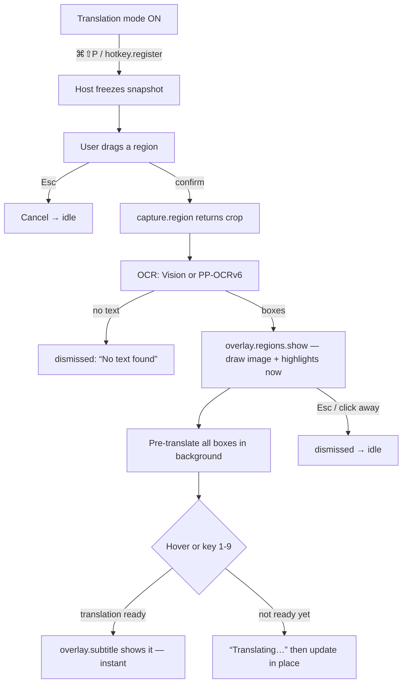

# Image Translate

**A SubTr plugin that reads the text in a screen region and lets you hover any
line to see its translation — without touching the picture.**

You press a global shortcut, drag a box around something on screen (a menu, a
web page, a photo, a game HUD), and the text in that box gets recognised on your
machine. The captured image stays exactly as it was; SubTr draws soft
Live Text-style highlights over the text it found and shows the translation of a
highlighted line in the normal subtitle line when you hover it.

> **This is a separate project.** It has its own version numbers (starting at
> `0.1.0`) and is not part of SubTr's release train. It is also the reason to
> **extend the plugin system**: it asks the host for five capabilities that do
> not exist today. Those are listed below with exact shapes and land in a later
> wave (see [`docs/image-translate-plugin.md`](../../../docs/image-translate-plugin.md)).

## Build status (plugin 0.1.1)

The plugin runs end to end on macOS: **⌘⇧P** freezes the display, you frame a
region, the crop is read by an on-device **Apple Vision** helper, highlights are
drawn over the image, and hover translations stream into the normal subtitle
line. The helper is shipped prebuilt as a universal (arm64 + x86_64) binary in
`bin/vision-ocr`, so no Xcode / Command Line Tools install is required; if the
binary is missing the plugin compiles `vision-ocr.swift` on first use.

| File | State |
| --- | --- |
| `manifest.json` | Complete; requests the apiVersion-2 host capabilities it uses. |
| `index.cjs` | Capture → OCR → batched pre-translation → hover/select → subtitle. |
| `panel.html` | Live settings panel (engine status, diagnostic, shortcut, highlight style). |
| `bin/vision-ocr` | Prebuilt universal Vision helper (shipped in the plugin zip). |
| `vision-ocr.swift` | Helper source, used for compile-on-demand installs. |

PP-OCRv6 (Windows/Linux) remains a later phase; the panel labels it as such.

## What it does (user-approved target)

1. Translation mode is on. You press **⌘⇧P** (default; rebindable).
2. The screen **freezes first** — a full-screen snapshot is taken, then a
   selection layer appears on the display under your cursor. You drag a
   rectangle. (This is the Snipaste feel: what you frame is what you get, even
   if the thing behind it is animating.)
3. You confirm. SubTr reads the text inside the rectangle **on your machine**.
4. The image appears with **Live Text-style highlights** over the text regions.
   The picture itself is not modified and **the original text is never
   overwritten**.
5. **Hover** a highlighted box and its translation appears in the usual subtitle
   line. Translations are pre-computed right after OCR, so hover is instant.
6. **Press 1–9** to pick a box with the keyboard; the same translation shows.
7. **Esc** cancels at any point (during selection, or dismisses the highlights).

### Non-goals (v1)

- Editing or replacing the text in the image.
- Copy-to-clipboard of recognised text (easy to add later; not v1).
- Live (non-frozen) selection, magnifier loupe, or per-display pinning.
- OCR of handwriting or rotated text beyond what the engine gives us.
- Any cloud OCR. The image never leaves the machine; only the *recognised text*
  is sent for translation, through the app's existing profile.

## UX flow

### States

| State | What the user sees | Owner |
| --- | --- | --- |
| `idle` | Nothing. Hotkey is armed (only while translation mode is on). | host |
| `selecting` | Frozen screen dimmed; drag rectangle with size readout; Esc hint. | host |
| `reading` | Selection closes; subtitle line shows a quiet “Reading text…”. | plugin + host |
| `highlighted` | Image with highlighted boxes; numbers 1–9; subtitle hint “Hover or press 1–9”. | host (draws) + plugin (data) |
| `translating` | Box hovered before its translation is ready → subtitle shows “Translating…”. | plugin |
| `showing` | Subtitle shows the translation of the hovered/selected box. | host (renders) + plugin (text) |
| `dismissed` | Highlights and subtitle fade out. | host |
| `error` | A short, specific message in the subtitle line (see error table). | plugin |

### Flow



```
   ⌘⇧P
    │
    ▼
┌─────────────────────────┐   freeze happens BEFORE the overlay is shown,
│  FROZEN SCREEN + DRAG   │   so a moving video is captured as-is
│   ┌───────────────┐     │
│   │ select region │     │   ← Esc cancels here
│   └───────────────┘     │
└───────────┬─────────────┘
            │ confirm
            ▼
     ┌─────────────┐
     │  OCR (local)│  ~0.4–1.5 s warm
     └──────┬──────┘
            ▼
┌─────────────────────────┐        highlights drawn immediately;
│  IMAGE + HIGHLIGHTED    │        translations fill in behind the scenes
│  ▓▓▓ ▓▓▓▓  ▓▓           │  ← 1 2 3 … numbers map to boxes
│  (image unchanged)      │
└───────────┬─────────────┘
            │ hover box / press 1–9
            ▼
   ┌────────────────────────────────┐
   │ subtitle line: the translation │   hover → subtitle ≤ 150 ms
   └────────────────────────────────┘
```

## Host capability requests

These must all be added to the plugin system (and the host's consent list)
before this plugin can run. Shapes are written as the plugin expects to call
them; the host lane owns the implementation. Each is a **separate capability** so
the user grants them one by one.

### 1) `capture.region` — frozen-snapshot region capture

The host shows the whole selection experience and returns a crop. The plugin
never draws the selection UI itself (the sandboxed panel system cannot draw over
the desktop).

```ts
api.capture.region(options?: {
  mode?: "freeze" | "live";              // default "freeze" (snapshot first)
  displayId?: number;                    // default: display under the cursor
  includeCursor?: boolean;               // default false
  minSize?: { w: number; h: number };    // logical px, default { w: 8, h: 8 }
  showMagnifier?: boolean;               // default false
}): Promise<
  | {
      ok: true;
      imageDataUrl: string;              // "data:image/png;base64,…" — crop at device pixels
      widthPx: number;                   // crop size in image pixels (Retina-aware)
      heightPx: number;
      scaleFactor: number;               // display scale factor (1, 2, 1.5 …)
      rect: { x: number; y: number; w: number; h: number }; // logical px, display-local
      displayId: number;
    }
  | { ok: false; reason: "cancelled" | "no-permission" | "no-display" | "error"; message?: string }
>;
```

Notes for the host lane:

- One overlay window **per display**, sized to `display.bounds` (not `workArea`)
  so the menu bar and dock are selectable.
- Freeze the pixels **before** showing the overlay.
- Reuse the existing global **Esc** arm/disarm pattern
  (`desktop/main.cjs`: `armEsc`/`disarmEsc`) so Esc cancels selection.
- macOS screen capture needs Screen Recording permission; report
  `no-permission` rather than failing silently.

### 2) `overlay.regions` — draw the image with highlights, report hover/select

The highlight rendering is **host-rendered** (same reason as above). The plugin
sends normalized boxes; the host draws them in the overlay and reports
interaction back.

```ts
api.overlay.regions.show(payload: {
  imageDataUrl: string;                  // the captured (or cropped) image
  widthPx: number;
  heightPx: number;
  displayId?: number;
  boxes: Array<{
    id: string;                          // stable id for events
    xPct: number; yPct: number;          // 0..1, fraction of the image
    wPct: number; hPct: number;
    text?: string;                       // original OCR text (optional to draw)
  }>;
  style?: {
    highlight?: "glow" | "box" | "underline"; // default "glow" (Live Text look)
    accent?: string;                     // CSS color; default app accent
    numbered?: boolean;                  // draw 1..9 badges; default false (opt-in)
  };
  interactive?: boolean;                 // default true
}): Promise<{ ok: true; id: string } | { ok: false; reason: string }>;

api.overlay.regions.update(payload: {
  id: string;
  boxes?: Array<{ id: string; xPct: number; yPct: number; wPct: number; hPct: number; text?: string }>;
  style?: { highlight?: "glow" | "box" | "underline"; accent?: string; numbered?: boolean };
}): Promise<{ ok: boolean }>;

api.overlay.regions.hide(payload?: { id?: string }): Promise<void>;

// host → plugin events
api.overlay.regions.onRegionHover(
  fn: (e: { id: string; boxId: string | null }) => void
): void;
api.overlay.regions.onRegionSelect(
  fn: (e: { id: string; boxId: string; index: number }) => void   // 1-based index (keys 1–9)
): void;
api.overlay.regions.onRegionDismiss(
  fn: (e: { id: string; reason: "esc" | "click-away" | "host" }) => void
): void;
```

Notes for the host lane:

- Draw over the overlay window; keep clicks working (`setIgnoreMouseEvents`
  toggling as the overlay already does) and forward number keys 1–9.
- Dismiss on Esc or click-away, then emit `onRegionDismiss`.
- The image is drawn as-is; the host must not alter it.

### 3) `overlay.subtitle` — the normal subtitle line, as text

```ts
api.overlay.subtitle.show(payload: {
  text: string;
  tone?: "normal" | "muted";   // "muted" for the tentative hover preview
  stickyMs?: number;           // keep visible this long; default: until replaced
}): void;

api.overlay.subtitle.clear(): void;
```

Uses the **same rendering path as translations** (the existing subtitle overlay),
so styling, positioning, fade-out, and `prefers-reduced-motion` all match.

### 4) `translate.text` — translate through the app's active profile

The plugin never sees API keys or base URLs. It sends text, the app translates
using the profile that is currently active.

```ts
api.translate.text(input: {
  texts: string[];             // 1..N; batch to keep hover instant
  targetLang?: string;         // default: the app's active target language
  sourceLang?: string;         // default "auto"
  context?: string;            // optional hint (e.g. "menu labels, software UI")
}): Promise<
  | {
      ok: true;
      translations: Array<{ text: string; detectedSourceLang?: string }>; // same order + length as `texts`
      usage?: { inTokens?: number; outTokens?: number; ms?: number };
    }
  | { ok: false; reason: "no-profile" | "upstream" | "timeout" | "cancelled"; message?: string }
>;

// optional (P3): stream as boxes resolve
api.translate.streamText?.(
  input: { texts: string[]; targetLang?: string; sourceLang?: string; context?: string },
  handlers: { onDelta: (index: number, delta: string) => void }
): Promise<{ ok: true; translations: Array<{ text: string }> } | { ok: false; reason: string }>;
```

Notes for the host lane:

- Distinct from the existing `translate.transformInput/Output` hooks, which
  *mutate* the app's own pipeline. This is an *outbound* call the plugin makes.
- Runs through `/api/translate` machinery with the active profile, so plugin
  transforms/billing/usage/stats all apply as usual.
- Batch is required: a screenshot can hold 10–40 lines, and one request per line
  would blow the 150 ms hover target.

### 5) `hotkey.register` — a global shortcut owned by the plugin

```ts
api.hotkey.register(input: {
  accelerator: string;                          // Electron accelerator, e.g. "CommandOrControl+Shift+P"
  onTrigger: (e: { accelerator: string }) => void;
  when?: "translation-mode" | "always";         // default "translation-mode"
}): Promise<
  | { ok: true; accelerator: string }
  | { ok: false; reason: "conflict" | "invalid" | "reserved"; conflicting?: string }
>;

api.hotkey.isRegistered(input: { accelerator: string }): boolean;
api.hotkey.unregister(input: { accelerator: string }): void;
```

Notes for the host lane:

- Reuse the validate + register + restore-previous logic already in
  `setToggleHotkey` (`desktop/main.cjs`).
- `when: "translation-mode"` means the shortcut only fires while the app is in
  translation mode — the same gate the plugin exists to serve.
- Report `conflict` when another app or SubTr already owns the accelerator, so
  the settings panel can suggest an alternative (see `SUGGESTED_HOTKEYS` in
  `src/lib/client/hotkey.ts`).

### 6) Plugin-local dependencies (loader change, not a capability)

The PP-OCRv6 path needs Node packages (`onnxruntime-node` and/or
`ppu-paddle-ocr`) and ONNX model files that are far too large to bundle in the
app. The plugin must ship **its own `node_modules`** inside the plugin folder.

Rules the loader must follow:

- Resolve `require()` from the **plugin directory**, e.g.
  `createRequire(path.join(pluginDir, "index.cjs"))`, so a plugin's own deps are
  used and the host's dependency tree is untouched.
- Do **not** add plugin-only packages to the app's `package.json`.
- Keep the plugin folder self-contained and portable: `manifest.json`,
  `index.cjs`, `panel.html`, `node_modules/`, model files, `LICENSE`/`NOTICE`.

Size expectations (order of magnitude, to be confirmed in P2):

| Item | Approx. size | Notes |
| --- | --- | --- |
| Apple Vision path | ~0 | System framework; only the helper binary (small). |
| `onnxruntime-node` | ~30–90 MB | Platform-specific native binaries. |
| PP-OCRv6 det + rec models | ~10–20 MB | Downloaded on first use, not bundled. |
| App itself | unchanged | Nothing added to the app's `package.json`. |

Because plugin zips are capped (see `MAX_PLUGIN_ZIP_BYTES` in
`src/lib/server/plugins.ts`), the Vision path is the default installer and the
PP-OCRv6 weights are fetched on demand.

### 7) Nice-to-haves (not required for v1)

- **`storage.plugin`** — per-plugin persisted settings, so the engine choice,
  hotkey, language pair, and highlight style survive restarts:

  ```ts
  api.storage.get<T>(key: string, fallback: T): Promise<T>;
  api.storage.set(key: string, value: unknown): Promise<void>;
  ```

  Until it exists, settings live in the panel's own `localStorage` and are
  re-sent on load.

- **Structured logging panel** — a plugin-visible log so users can see
  “permission denied”, “model missing”, “OCR returned 0 boxes” without digging
  through the terminal.

## OCR engine matrix

The plugin picks an engine at runtime. **Auto** = Vision on macOS, PP-OCRv6
everywhere else.

| | **Apple Vision** (`VNRecognizeTextRequest`) | **PP-OCRv6** (ONNX det + rec) |
| --- | --- | --- |
| Platforms | macOS only | macOS, Windows, Linux |
| Cost / download | Free, built in, zero download | Models downloaded on first use (or bundled) |
| Languages | `zh-Hans` + `en-US` (per request) | Chinese + English; more via other models |
| Boxes + confidence | Yes — bounding boxes, per-box confidence, top candidates | Yes — detection boxes + recognition scores |
| Speed (warm, 800×600 crop) | ~0.4–1.0 s | ~1.5–2.5 s on CPU (no GPU assumed) |
| Packaging | Small helper binary; **needs ad-hoc codesign** on macOS | `onnxruntime-node` + model files via plugin `node_modules` |
| Failure mode | Missing/untrusted helper → fall back to PP-OCRv6 | Missing model → prompt download |
| License | Apple SDK terms (system framework) | Apache-2.0 (PaddleOCR) + MIT wrapper — **notice required** |

Detection detail: Vision returns `VNRecognizedTextObservation` boxes (normalized
0–1, origin bottom-left — the plugin flips `y` for the host) plus candidates.
PP-OCRv6 returns axis-aligned quads from the det model and text + score from the
rec model; quads are converted to normalized axis-aligned boxes.

## Licensing and NOTICE

The app is free, but the PP-OCRv6 path redistributes third-party work, so those
notices are required. Ship a `NOTICE` (and the full license text) inside the
plugin folder and repeat the attribution in the About/credits screen.

| Component | License | Obligation |
| --- | --- | --- |
| PaddleOCR / PP-OCRv6 models | Apache-2.0 | Include the license text + `NOTICE`; keep attribution. |
| `ppu-paddle-ocr` (wrapper) | MIT | Include the copyright + license text. |
| `onnxruntime-node` | MIT | Include the copyright + license text. |
| Apple Vision | Apple SDK / system framework | No redistribution; link only. |
| Model mirrors | HF → hf-mirror → ModelScope → PaddleX BOS | Download-only; verify `sha256` before use. |

Apache-2.0 NOTICE template to adapt:

```
This product includes software developed by PaddlePaddle (PaddleOCR),
licensed under the Apache License, Version 2.0.
Copyright 2020-2026 PaddlePaddle Authors. https://github.com/PaddlePaddle/PaddleOCR

PP-OCRv6 detection and recognition models: Apache-2.0.
Model files are downloaded on first use and verified by SHA-256.
```

Verification rule: every downloaded model file must match a pinned SHA-256
before it is loaded. A mismatch is a hard failure, not a warning.

## Performance targets

| Path | Target | How |
| --- | --- | --- |
| Hotkey → selection layer visible | ≤ 100 ms | Host snapshot + overlay show. |
| Confirm → boxes drawn (warm, Vision) | **≤ 1.5 s** total | Vision on a ≤ 800×600 crop; boxes drawn before translation. |
| Confirm → boxes drawn (cold, first Vision call) | ≤ 2.5 s | Helper spawn included. |
| Confirm → boxes drawn (PP-OCRv6, CPU) | ≤ 2.5 s | det+rec; no GPU assumed. |
| **Hover → subtitle text** | **≤ 150 ms** | Pre-translation right after OCR; hover is a map lookup + one IPC. |
| Pre-translation of all boxes | ≤ 3 s, non-blocking | One batched `translate.text` call; highlights never wait on it. |
| Hover before translation is ready | shows “Translating…”, updates in place | No layout shift. |

If pre-translation misses the window, a hover still works — it just shows
“Translating…” first and fills in. The 150 ms budget is the *warm* case.

## Error and fallback states

Every failure speaks in the subtitle line, short and specific. No modal dialogs.

| Situation | Detection | What the user sees | Recovery |
| --- | --- | --- | --- |
| No Screen Recording permission (macOS) | `capture.region` → `no-permission` | “Screen recording is off — enable it in System Settings.” | Deep-link to Privacy settings; keep highlights hidden. |
| No display / capture failed | `capture.region` → `no-display` / `error` | “Couldn't capture the screen.” | Retry with the hotkey. |
| User cancels selection | `capture.region` → `cancelled` (or Esc) | Nothing (silent). | — |
| OCR returns zero boxes | engine result has no boxes | “No text found in that area.” | Try a tighter selection. |
| Vision helper unusable / not signed | helper spawn fails | Silent fallback to PP-OCRv6; if that also fails: “Text engine unavailable.” | Panel shows engine status. |
| PP-OCRv6 model missing | model not present | “Text model not downloaded.” (panel offers **Download**) | Download with progress; retry. |
| Model download/verify failed | SHA-256 mismatch or network | “Model download failed — try again.” | Retry; try the next mirror. |
| No active profile | `translate.text` → `no-profile` | Boxes still draw; “Add a profile to translate.” | Link to Settings → Profiles. |
| Translation upstream error/timeout | `translate.text` → `upstream` / `timeout` | “Translation failed.” on that box; others still work. | Retry on next hover. |
| Hotkey conflict | `hotkey.register` → `conflict` | Panel: “⌘⇧P is taken — pick another.” | Choose a suggested accelerator. |
| Displays changed mid-capture | display removed while selecting | Abort capture, dismiss. | Retry. |

## Packaging rules

- The folder is self-contained: `manifest.json`, `index.cjs`, `panel.html`,
  `node_modules/`, models, `NOTICE`, `LICENSE`.
- `index.cjs` loads its deps via `createRequire(pluginDir)` (see item 6).
- Keep `README.md` in the folder, but **`node_modules/` and model files must be
  excluded from any distributable zip** — the current
  `scripts/build-plugin-zips.mjs` walks the whole folder, so a `.zipignore`
  (or a build-script skip list) is needed before PP-OCRv6 can be packaged. This
  is a **P4 task** and a tracked risk.
- Two distribution shapes are planned:
  1. **Lite** (default): Vision only, no `node_modules`, tiny zip.
  2. **Full**: includes `onnxruntime-node` + models for Windows/Linux and
     non-Vision macOS.

## Settings panel (`panel.html`)

Lives at Settings → Plugins → Image Translate (`location: "settings"`). It is a
shell today — it renders from a static `CONFIG` object and the interactive bits
are stubs marked `TODO`. Contents:

- **Engine** — segmented control: Auto / Apple Vision / PP-OCRv6, each with a
  one-line hint.
- **Model status** — engine, model name/size, and a state badge (Ready /
  Downloading / Not downloaded / Not needed). Static placeholder for now.
- **Shortcut** — shows the current accelerator (⌘⇧P) and a **Test hotkey** stub.
- **Highlight style** — Glow / Box / Underline, with a small live preview strip.
- **Footer note** — “Translation uses the app's active profile; target language
  follows the app setting.”

Preview the panel states without enabling the plugin by adding `?demo=` to the
preview URL once the host serves it: `/panel-preview/image-translate/settings?demo=loading|empty|error`.

## Planned settings schema

```jsonc
{
  "engine": "auto",                 // "auto" | "vision" | "ppocrv6"
  "accelerator": "CommandOrControl+Shift+P",
  "when": "translation-mode",       // "translation-mode" | "always"
  "targetLang": "auto",             // follows the app when "auto"
  "highlight": "glow",              // "glow" | "box" | "underline"
  "numbered": false,
  "autoTranslate": true,            // pre-translate boxes after OCR
  "modelMirrorOrder": ["hf", "hf-mirror", "modelscope", "paddlex-bos"]
}
```

## Folder layout

```
examples/plugins/image-translate/
├── manifest.json      # capabilities wishlist + settings panel declaration
├── index.cjs          # SKELETON: OCR orchestration, translation batching, region state
├── panel.html         # settings-panel shell on /plugin-kit/panel.css
├── README.md          # this spec
├── NOTICE             # P2: Apache-2.0 + MIT attributions (to be added)
├── LICENSE            # P2
└── node_modules/      # P2 (PP-OCRv6 path only; never zipped)
```

## Architecture split

- **`index.cjs` (Node):** OCR orchestration, translation batching, region state,
  engine selection, model download/verify. It does **not** draw anything.
- **Host (via `overlay.regions` / `overlay.subtitle`):** all rendering over the
  desktop and the subtitle line. The sandboxed panel system cannot draw over the
  desktop, which is exactly why these capabilities exist.
- **`panel.html` (sandboxed iframe):** the plugin's own settings only.

## Open questions

1. **`minAppVersion`.** Set to `0.2.9` per the approved brief, but the
   capabilities do not exist in `0.2.9`. It should be bumped to the first host
   version that ships them before release. (The loader currently stores but does
   not enforce this field.)
2. **Vision helper signing.** Ship a prebuilt helper binary, or compile on first
   run? Ad-hoc codesign is required either way; a notarised helper would remove
   the Gatekeeper prompt but adds release machinery.
3. **Model bundling for the Full install.** Download-on-first-use is lighter but
   needs network and mirrors; bundling is offline-friendly but heavy and hits the
   zip size cap. Which ships as the default for Windows/Linux?
4. **Multi-language beyond zh/en.** Vision is limited to `zh-Hans` + `en-US` per
   request; PP-OCRv6 can carry more models. Is a third language expected in v1?
5. **Box granularity.** One box per detected line, or merge into paragraphs? Live
   Text feels line-by-line; translation quality often prefers whole sentences.
6. **Selected-box behaviour.** Should pressing 1–9 pin the translation, or
   replace the hover line (current plan: replace, transiently)?
